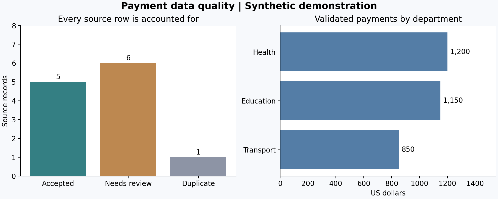
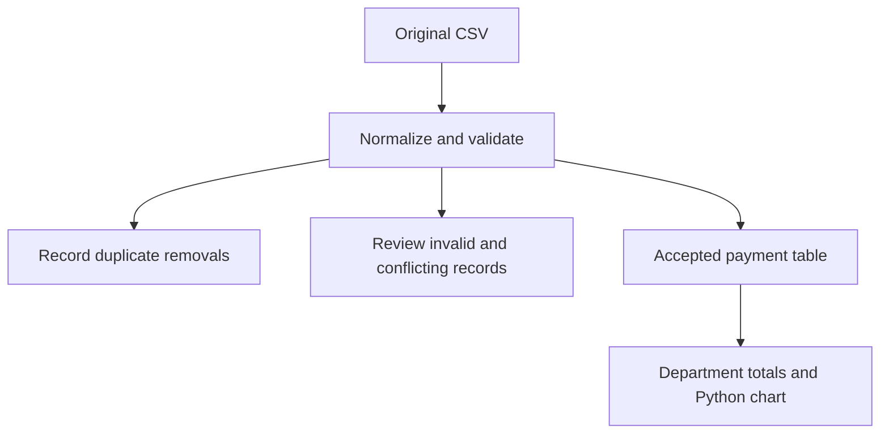

# Payment Data Quality Pipeline

A small, reproducible SQL and Python project: preserve messy payment records, explain every exclusion, and produce a trusted reporting table.

**Synthetic data only. This is a working demonstration, not an audit of real government spending.**

## Result

12 input rows = 5 accepted + 6 requiring review + 1 duplicate.
Validated payments total **$3,200**: Education $1,150; Health $1,200; Transport $850.
These are accepted records, not a claim that unresolved payments have no financial value.

## Run entirely in your browser

1. Open https://colab.research.google.com/ and choose **File → Upload notebook**.
2. Upload `payment_showcase.ipynb` from this project.
3. Choose **Runtime → Run all**. The notebook includes the data, SQL, and Python; no local installation or separate file upload is needed.
4. Expand the SQL and Python cells to inspect how each result is produced.

The notebook writes CSV outputs and displays the chart. A Google account and a Colab runtime are needed. If matplotlib is absent from a runtime, use its package installation cell in the browser; nothing is installed on your computer.

## Data flow

## What gets cleaned

| Source problem | Rule | Outcome |
|---|---|---|
| ` Health ` and `health` | Trim spaces and standardize case | Same department |
| Repeated payment 101 | Match all normalized business fields | Keep first source row; log duplicate |
| `unknown` amount | Strict decimal parsing | Review; never replace with zero |
| Negative payment | Project assumes outgoing payments | Review; refunds need a separate business rule |
| February 30 | Strict calendar validation | Review |
| Payment 107 has two amounts | Same ID, different records | Review both; do not guess |
| Missing payment ID | Require business key | Review |
| Zero payment | Explicitly permitted in this demo | Accept |

## Code and evidence

- [SQL transformations](clean_payments.sql)
- [Python pipeline and visualization](pipeline.py)
- [Browser notebook](payment_showcase.ipynb)
- [Original sample data](messy_payments.csv)
- [Accepted records](outputs/clean_payments.csv)
- [Review queue with reasons](outputs/rejected_payments.csv)
- [Duplicate log](outputs/duplicate_log.csv)
- [Reporting totals](outputs/payment_summary.csv)

Amounts are stored as integer cents to avoid floating-point rounding errors. Python registers `cents()` and `valid_date()` with SQLite; run the SQL through the notebook or Python script, not alone in another SQL engine. The review reason is the first matching validation failure, not a complete list of every possible error.

## Checks performed

Row conservation, expected sample totals, unique accepted payment IDs, invalid dates, non-finite and over-precision amounts, and repeatable transformations. Review rows remain separate from accepted reporting.

## Boundaries

This demo uses an in-memory database and a small fixture. Production work would also need source contracts, access controls, incremental loads, cross-run deduplication, monitoring, retention, and a reviewed process for correcting rejected records. No production deployment or measured business savings are claimed.
